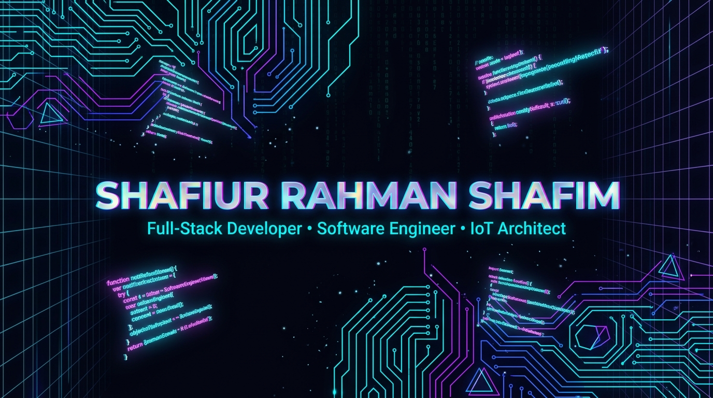
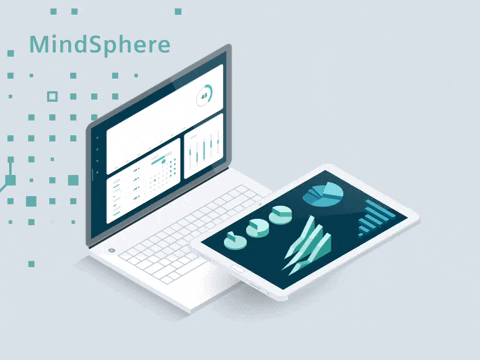
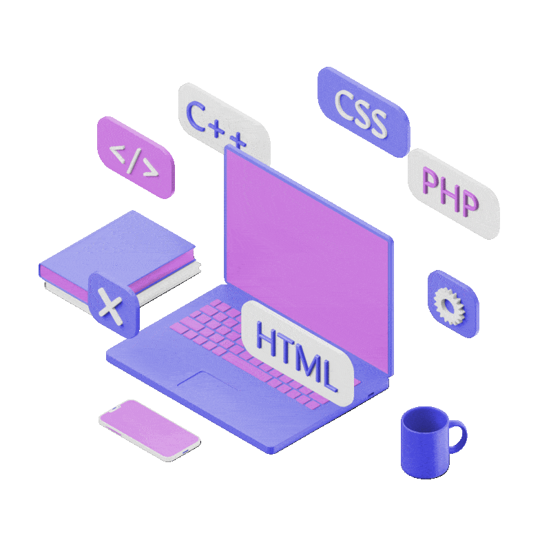
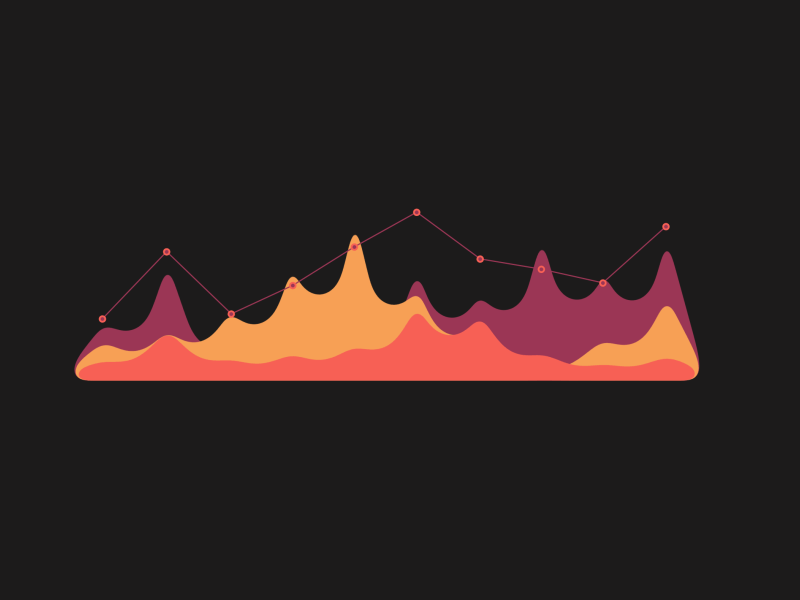
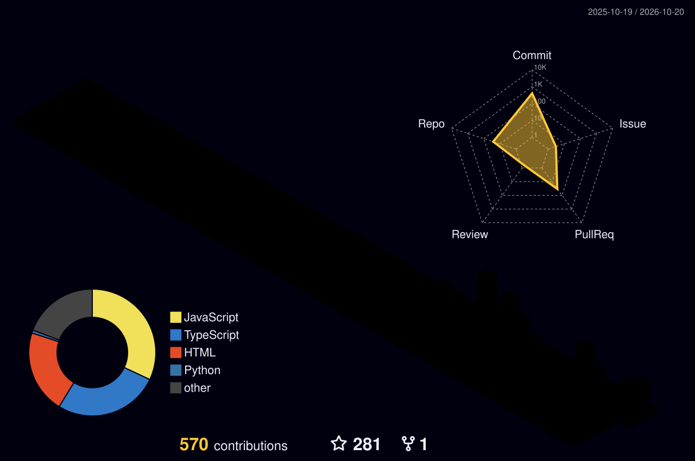

<div align="center">

<!-- ═══════════════════════════════════════════════════════════════════ -->
<!-- 3D BROWSER / OS WINDOW FRAME WITH ANIMATED CORE -->
<!-- ═══════════════════════════════════════════════════════════════════ -->

<table border="0" cellpadding="0" cellspacing="0" width="100%">
<tr>
<td align="left" style="background: #111827; padding: 10px 16px; border-radius: 12px 12px 0 0; border-bottom: 2px solid #1f293d;">
  <span style="color: #ff5f56; font-size: 16px;">●</span>&nbsp;
  <span style="color: #ffbd2e; font-size: 16px;">●</span>&nbsp;
  <span style="color: #27c93f; font-size: 16px;">●</span>&nbsp;&nbsp;&nbsp;
  <code>🔒 https://shafim.dev/core-system &nbsp;—&nbsp; [ SHAFIUR RAHMAN SHAFIM // 3D OS ]</code>
</td>
</tr>
<tr>
<td align="center" style="background: #08090d; padding: 0;">
  <a href="https://shafim.vercel.app/" target="_blank">
    
  </a>
</td>
</tr>
</table>

<br/>

<!-- 3D Interactive Website Navigation Bar -->
<p align="center">
  <a href="#-about-system"></a>&nbsp;
  <a href="#-tech-matrix"></a>&nbsp;
  <a href="#-featured-ventures"></a>&nbsp;
  <a href="#-hall-of-fame"></a>&nbsp;
  <a href="#-telemetry-matrix"></a>&nbsp;
  <a href="#-quantum-uplink"></a>
</p>

<!-- Live Telemetry Status Pill -->
<p align="center">
  <code>🟢 SYSTEM ONLINE</code> &nbsp;|&nbsp;
  <code>⚡ FULL-STACK & IOT ARCHITECT</code> &nbsp;|&nbsp;
  <code>📍 DHAKA, BD</code> &nbsp;|&nbsp;
  <code>🎯 AVAILABLE FOR HIRE & COLLABORATION</code>
</p>

<!-- Dynamic Electric Cyan Typing Banner -->
<a href="https://shafim.vercel.app/">
  
</a>

<br/>

<!-- Interactive Quick Links -->
<p align="center">
  <a href="https://shafim.vercel.app/" target="_blank"></a>&nbsp;
  <a href="https://www.linkedin.com/in/shafiur-rahman-shafim/" target="_blank"></a>&nbsp;
  <a href="mailto:srprogramme830@gmail.com"></a>&nbsp;
  <a href="https://leetcode.com/u/shafiurrahmanshafim/" target="_blank"></a>
</p>

</div>

<!-- 2px Neon Gradient Laser Line -->
<p align="center">
  
</p>

<!-- ═══════════════════════════════════════════════════════════════════ -->
<!-- SECTION 01: SYSTEM CORE // DEVELOPER ARCHITECTURE & 3D ANIMATION -->
<!-- ═══════════════════════════════════════════════════════════════════ -->

<h3 id="-about-system">💻 <code>[ 01 ] SYSTEM_CORE // DEVELOPER ARCHITECTURE</code></h3>

<table border="0" cellpadding="0" cellspacing="0" width="100%">
<tr>
<td width="55%" valign="top">

```typescript
/**
 * @architect Shafiur Rahman Shafim
 * @role Lead Full-Stack & IoT Systems Engineer
 */
const shafim: ArchitectCore = {
  identity: {
    handle: "Shafiur0",
    name: "Shafiur Rahman Shafim",
    education: "B.Sc. Software Engineering @ Daffodil Int. University",
    hq: "Dhaka, Bangladesh 🇧🇩",
    leadership: "Cortex Crew [Lead Software & Robotics Architect]"
  },
  disciplines: [
    "Full-Stack Cloud Architectures (React / Next.js / Node.js)",
    "Distributed Hardware IoT & Microcomputing (ESP32 / Arduino C++)",
    "Applied Machine Learning & Medical Screening Systems",
    "Autonomous Robotics & Edge Automation"
  ],
  motto: "Bridging scalable digital intelligence with physical embedded hardware.",
  status: "🟢 OPEN FOR EXCITING OPPORTUNITIES"
};
```

</td>
<td width="45%" align="center" valign="middle">

<!-- 3D Rotating Holographic Cyber Sphere -->

<br/>
<sub><i>🌐 3D Neural MindSphere Core</i></sub>

</td>
</tr>
</table>

<br/>

<!-- 3D ANIMATED DEVELOPER LAB SHOWCASE -->
<div align="center">
  
  <p><sub><i>🖥️ <b>3D Interactive R&D Lab</b> — Where multi-threaded cloud logic, neural networks, and embedded IoT microcontrollers operate in real-time.</i></sub></p>
</div>

<!-- 2px Neon Gradient Laser Line -->
<p align="center">
  
</p>

<!-- ═══════════════════════════════════════════════════════════════════ -->
<!-- SECTION 02: TECH MATRIX // 3D FLOATING TECH ANIMATION -->
<!-- ═══════════════════════════════════════════════════════════════════ -->

<div align="center">

<h3 id="-tech-matrix">⚙️ <code>[ 02 ] TECH_MATRIX // WEAPONS OF CHOICE</code></h3>

<br/>

<!-- 3D Floating Isometric Tech Cubes Animation -->


<br/><br/>

<table border="0" cellpadding="8" cellspacing="0" width="100%">
<tr>
<td align="center" width="33%" valign="top">
<b>⚡ FRONTEND ARCHITECTURE</b><br/><br/>
<a href="https://skillicons.dev">
  
</a>
<br/><br/>
<sub>React 18/19 • Next.js • TypeScript • Tailwind CSS • Modern Responsive UI</sub>
</td>
<td align="center" width="33%" valign="top">
<b>🛠️ BACKEND & SYSTEMS</b><br/><br/>
<a href="https://skillicons.dev">
  
</a>
<br/><br/>
<sub>Node.js • Express • RESTful APIs • Python • C/C++ Embedded Logic</sub>
</td>
<td align="center" width="33%" valign="top">
<b>🗄️ DATA & DEVOPS</b><br/><br/>
<a href="https://skillicons.dev">
  
</a>
<br/><br/>
<sub>MongoDB • PostgreSQL • Docker • Linux • AWS Cloud • CI/CD</sub>
</td>
</tr>
<tr>
<td colspan="3" align="center" valign="top">
<b>🤖 IOT, EMBEDDED HARDWARE & ROBOTICS</b><br/><br/>
<a href="https://skillicons.dev">
  
</a>
<br/><br/>
<sub>Arduino C++ • Raspberry Pi Microcomputing • ESP32 • Sensor Networks • Edge Robotics</sub>
</td>
</tr>
</table>

</div>

<!-- 2px Neon Gradient Laser Line -->
<p align="center">
  
</p>

<!-- ═══════════════════════════════════════════════════════════════════ -->
<!-- SECTION 03: ACTIVE VENTURES & FEATURED CODEBASES -->
<!-- ═══════════════════════════════════════════════════════════════════ -->

<div align="center">

<h3 id="-featured-ventures">🚀 <code>[ 03 ] VENTURES // HIGH-IMPACT CODEBASES</code></h3>

<br/>

<!-- Interactive Live GitHub Pins -->
<a href="https://github.com/Shafiur0/bd-krishibid" target="_blank">
  
</a>&nbsp;&nbsp;
<a href="https://github.com/Shafiur0/nexora-portfolio" target="_blank">
  
</a>

<br/><br/>

</div>

<!-- Interactive Expandable 3D Project Accordions -->
<details open>
<summary><b>🌾 BD-Krishibid — AI AgriTech Intelligence Engine (5th Data Science Summit Finalist)</b></summary>
<br/>

> 🏅 **5th Data Science Summit Finalist — DIU SWE Conference**

Next-generation agricultural platform engineered for Bangladeshi farmers. Combines machine learning crop recommendation models, computer-vision plant pathology diagnosis, and real-time commodity trade price analytics.
- **Stack**: React, Node.js, Express, MongoDB, Python (Scikit-Learn, OpenCV)
- **Key Features**: Automated Disease Detection, Predictive Crop Yields, Multilingual UI, Live Market Feed
- **Repository**: [github.com/Shafiur0/bd-krishibid](https://github.com/Shafiur0/bd-krishibid)

</details>

<br/>

<details open>
<summary><b>🩺 NIiro 2.0 — Health AI Medical Screening Research (IEEE ICADHI 2026 Awardee)</b></summary>
<br/>

> 🥈 **1st Runner-Up @ IEEE ICADHI 2026 International Conference Project Showcase**

Biomedical intelligence platform engineered with deep learning computer vision for early non-invasive medical screening and clinical diagnosis support.
- **Stack**: Python, TensorFlow, FastAPI, React, OpenCV
- **Key Features**: Automated Pathology Screening, High-Precision Inference, Real-Time Diagnostic Reports

</details>

<br/>

<details>
<summary><b>🏠 Smart Home & Distributed IoT Ecosystem (Hardware & Sensor Automation)</b></summary>
<br/>

Distributed IoT home automation and environmental telemetry architecture built with microcontrollers, wireless mesh, and cloud control dashboards.
- **Stack**: ESP32, Arduino C++, MQTT, Node.js, WebSockets, Sensor Arrays
- **Key Features**: Low-latency sensor telemetry, automated power management, remote mobile dashboard

</details>

<br/>

<!-- 2px Neon Gradient Laser Line -->
<p align="center">
  
</p>

<!-- ═══════════════════════════════════════════════════════════════════ -->
<!-- SECTION 04: HALL OF FAME // HONORS & RECOGNITION -->
<!-- ═══════════════════════════════════════════════════════════════════ -->

<div align="center">

<h3 id="-hall-of-fame">🏆 <code>[ 04 ] HALL_OF_FAME // HONORS & RECOGNITION</code></h3>

<br/>

<table border="0" cellpadding="8" cellspacing="0" width="100%">
<tr>
<td align="center" width="25%" valign="top">
  <br/>
  
  <br/><br/>
  <b>CSAD 2026</b><br/>
  <sub>Cyber Security Center, DIU</sub><br/><br/>
  <code>Project: DREAKTARACE3</code>
  <br/><br/>
</td>
<td align="center" width="25%" valign="top">
  <br/>
  
  <br/><br/>
  <b>IEEE ICADHI 2026</b><br/>
  <sub>International Conference</sub><br/><br/>
  <code>Project: NIiro 2.0 (Health AI)</code>
  <br/><br/>
</td>
<td align="center" width="25%" valign="top">
  <br/>
  
  <br/><br/>
  <b>5th Data Science Summit</b><br/>
  <sub>DIU SWE Conference</sub><br/><br/>
  <code>Project: BD-Krishibid</code>
  <br/><br/>
</td>
<td align="center" width="25%" valign="top">
  <br/>
  
  <br/><br/>
  <b>UFTB RoboFusion 1.0</b><br/>
  <sub>National Robotics Festival</sub><br/><br/>
  <code>Team: Cortex Crew</code>
  <br/><br/>
</td>
</tr>
</table>

</div>

<!-- 2px Neon Gradient Laser Line -->
<p align="center">
  
</p>

<!-- ═══════════════════════════════════════════════════════════════════ -->
<!-- SECTION 05: TELEMETRY MATRIX & 3D ANIMATED STATS -->
<!-- ═══════════════════════════════════════════════════════════════════ -->

<div align="center">

<h3 id="-telemetry-matrix">📊 <code>[ 05 ] TELEMETRY_MATRIX // 3D GITHUB VELOCITY</code></h3>

<br/>

<!-- 3D Holographic Telemetry Animation -->


<br/><br/>

<p>
  &nbsp;
  &nbsp;
  
</p>

<br/>

<!-- Live GitHub Stats & Streak Cards -->


<br/><br/>

<!-- 3D Isometric City Contribution Graph -->
<b>🏙️ 3D ISOMETRIC CONTRIBUTION CITY // CODE SKYLINE</b>

<br/><br/>



<br/><br/>

<!-- Contribution Grid Snake Matrix Animation -->
<b>🐍 CODE VELOCITY // CONTRIBUTION MATRIX ANIMATION</b>

<br/><br/>

<picture>
  <source media="(prefers-color-scheme: dark)" srcset="https://raw.githubusercontent.com/Shafiur0/Shafiur0/output/github-contribution-grid-snake-dark.svg" />
  <source media="(prefers-color-scheme: light)" srcset="https://raw.githubusercontent.com/Shafiur0/Shafiur0/output/github-contribution-grid-snake.svg" />
  
</picture>

</div>

<!-- 2px Neon Gradient Laser Line -->
<p align="center">
  
</p>

<!-- ═══════════════════════════════════════════════════════════════════ -->
<!-- SECTION 06: QUANTUM UPLINK // INITIALIZE CONNECTION -->
<!-- ═══════════════════════════════════════════════════════════════════ -->

<div align="center">

<h3 id="-quantum-uplink">📡 <code>[ 06 ] QUANTUM_UPLINK // INITIALIZE CONNECTION</code></h3>

<p>Have an ambitious project, research collaboration, or engineering challenge? Let's build together.</p>

<br/>

<p>
  <a href="https://shafim.vercel.app/" target="_blank"></a>&nbsp;
  <a href="https://shafiur-rahaman-shafim.vercel.app/" target="_blank"></a>&nbsp;
  <a href="https://www.linkedin.com/in/shafiur-rahman-shafim/" target="_blank"></a>
</p>

<p>
  <a href="https://www.youtube.com/@ShafiurRahmanShafim" target="_blank"></a>&nbsp;
  <a href="http://x.com/Shafiur792" target="_blank"></a>&nbsp;
  <a href="https://www.facebook.com/shafiurrahaman.shafim" target="_blank"></a>&nbsp;
  <a href="https://www.instagram.com/shafiurshafim" target="_blank"></a>
</p>

<br/>

<!-- Modern Dev Quote -->


<br/><br/>

<!-- Sleek Animated Footer Wave -->


<br/>

<sub>⚡ <b>ENGINEERED FOR THE FUTURE</b> by <a href="https://shafim.vercel.app/">Shafiur Rahman Shafim</a> • Cortex Crew • Dhaka, Bangladesh</sub>

</div>
