

  

<a href="#user-content-stack">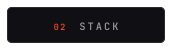</a><a href="#user-content-work">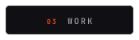</a><a href="#user-content-awards">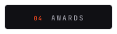</a><a href="#user-content-stats">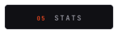</a><a href="#user-content-contact">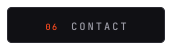</a>

 

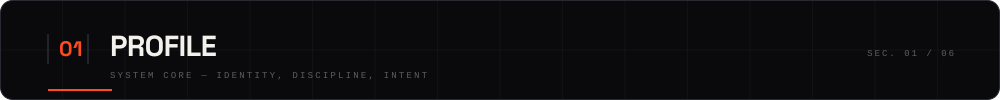

I'm a software engineering student in Dhaka who builds across the whole stack — and then past it, into the hardware. My work usually starts as a web platform and ends up talking to microcontrollers, or the other way round.

Most of what I ship lives at the seam between three things: **cloud software** that has to stay up, **embedded firmware** that has to stay responsive, and **machine learning** that has to stay honest about what it can actually predict. I lead software and robotics for **Cortex Crew**, where that mix has turned into award-winning agritech, medical screening, and autonomous hardware projects.

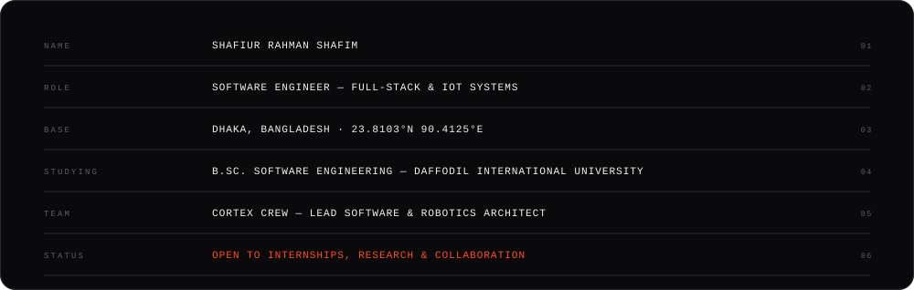

 

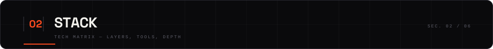

Five layers, one mental model. I care less about which framework is fashionable and more about whether the whole pipeline holds when a sensor drops a packet at 3 a.m.

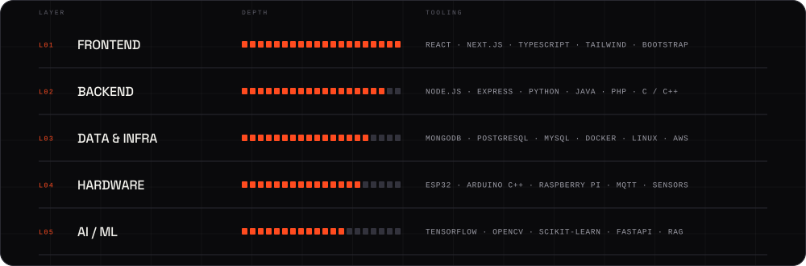

 

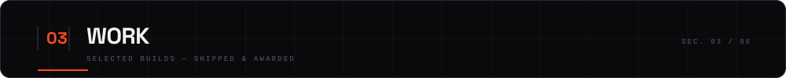

<a href="https://github.com/Shafiur0/bd-krishibid">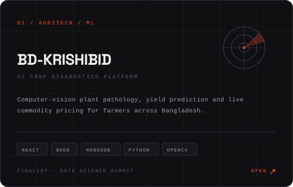</a> <a href="https://github.com/Shafiur0/AiDoc.s">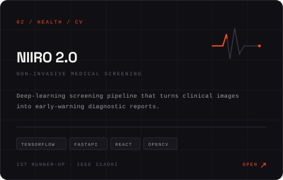</a>

<a href="https://github.com/Shafiur0">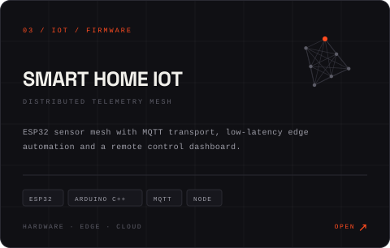</a> <a href="https://shafim.vercel.app/">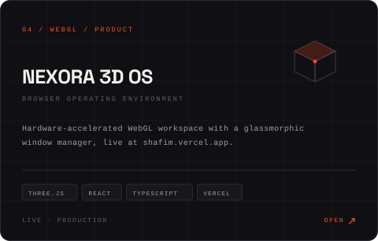</a>

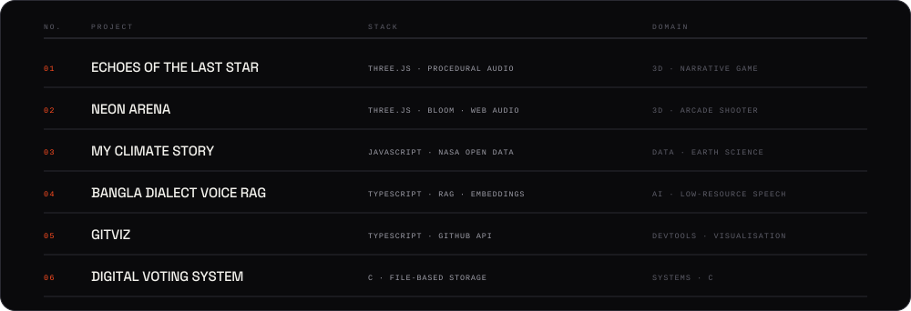

 

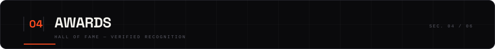

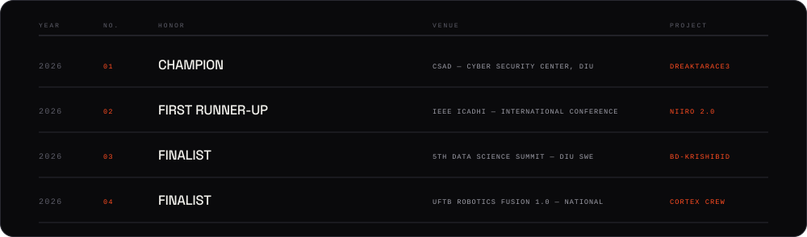

  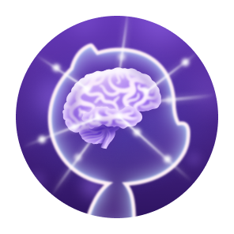
  &nbsp;&nbsp;
  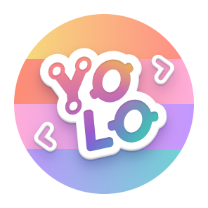
  &nbsp;&nbsp;
  
  &nbsp;&nbsp;
  
  &nbsp;&nbsp;
  
  &nbsp;&nbsp;
  

 

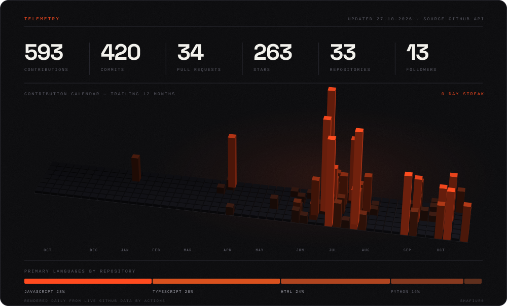

 

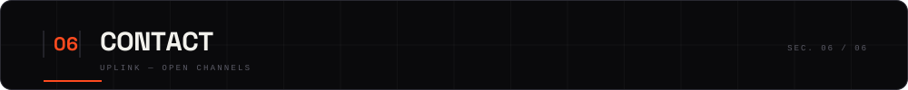

  Open to internships, research collaboration, and hard engineering problems.

<a href="mailto:srprogramme830@gmail.com">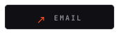</a><a href="https://github.com/Shafiur0">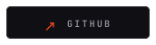</a><a href="https://x.com/Shafiur792">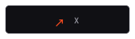</a>

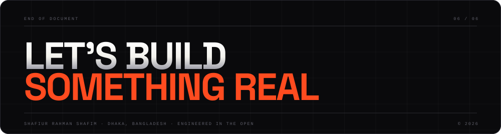
