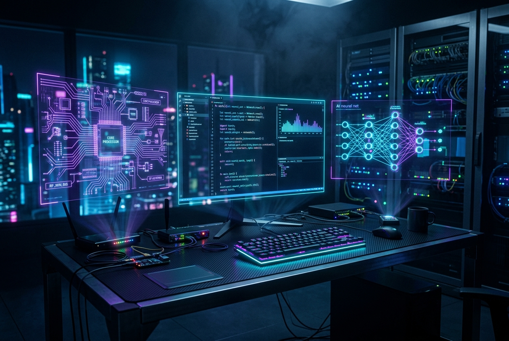

<div align="center">

<!-- ═══════════════════════════════════════════════════════════════════ -->
<!-- 3D CYBERPUNK HERO BANNER -->
<!-- ═══════════════════════════════════════════════════════════════════ -->


<br/><br/>

<!-- Holographic Typing Terminal -->
<a href="https://git.io/typing-svg">
  
</a>

<br/>

<!-- Quantum Hologram Quick Links -->
<p>
  <a href="https://shafim.vercel.app/" target="_blank"></a>&nbsp;
  <a href="https://shafiur-rahaman-shafim.vercel.app/" target="_blank"></a>&nbsp;
  <a href="https://www.linkedin.com/in/shafiur-rahman-shafim/" target="_blank"></a>&nbsp;
  <a href="mailto:srprogramme830@gmail.com"></a>&nbsp;
  <a href="https://leetcode.com/u/shafiurrahmanshafim/" target="_blank"></a>
</p>

<!-- Live Telemetry Visitor Badge -->
<p>
  
</p>

</div>

<!-- ═══════════════════════════════════════════════════════════════════ -->
<!-- NEON DIVIDER -->
<!-- ═══════════════════════════════════════════════════════════════════ -->


<br/>

<!-- ═══════════════════════════════════════════════════════════════════ -->
<!-- SYSTEM SPECS & DEVELOPER WORKSPACE -->
<!-- ═══════════════════════════════════════════════════════════════════ -->

<div align="center">
  <h2> <code>// SYSTEM_IDENTIFICATION & ARCHITECTURE</code></h2>
</div>

<br/>

<table>
<tr>
<td width="54%" valign="top">

```typescript
interface DeveloperCore {
  identity: {
    handle: "Shafiur0",
    name: "Shafiur Rahman Shafim",
    location: "Dhaka, Bangladesh 🇧🇩",
    institution: "Daffodil International University",
    major: "B.Sc. in Software Engineering",
    affiliation: "Cortex Crew [Team Lead / Architect]"
  };
  domainExpertise: [
    "Full-Stack Cloud Systems",
    "IoT Systems & Embedded Hardware",
    "AI/ML Research & Biomedical Platforms",
    "Robotics Engineering & Autonomous Logic"
  ];
  operationalStatus: {
    freelance: "AVAILABLE",
    internships: "OPEN_FOR_OPPORTUNITIES",
    collaborations: "ACTIVELY_SEEKING"
  };
  mantra: "Bridging the physical and digital through elegant engineering.";
}
```

</td>
<td width="46%" align="center" valign="middle">


</td>
</tr>
</table>

<br/>

<!-- Developer Workspace Hologram Showcase -->
<div align="center">
  
  <p><sub><i>🖥️ Holographic Workstation — Where scalable architectures, neural algorithms, and embedded IoT converge.</i></sub></p>
</div>

<br/>

<!-- ═══════════════════════════════════════════════════════════════════ -->
<!-- NEON DIVIDER -->
<!-- ═══════════════════════════════════════════════════════════════════ -->


<br/>

<!-- ═══════════════════════════════════════════════════════════════════ -->
<!-- HALL OF FAME / ACHIEVEMENTS -->
<!-- ═══════════════════════════════════════════════════════════════════ -->

<div align="center">

<h2>🏆 <code>HALL_OF_FAME // HONORS & AWARDS</code></h2>

<br/>

<!-- Custom Animated Glowing Achievements SVG -->


<br/><br/>

<table>
<tr>
<td align="center" width="25%">
  <br/><br/>
  <strong>CSAD 2026</strong><br/>
  <sub>Cyber Security Center, DIU</sub><br/><br/>
  <code>DREAKTARACE3</code>
</td>
<td align="center" width="25%">
  <br/><br/>
  <strong>IEEE ICADHI 2026</strong><br/>
  <sub>International Conference Showcase</sub><br/><br/>
  <code>NIiro 2.0</code>
</td>
<td align="center" width="25%">
  <br/><br/>
  <strong>5th Data Science Summit</strong><br/>
  <sub>DIU SWE Conference</sub><br/><br/>
  <code>BD-Krishibid</code>
</td>
<td align="center" width="25%">
  <br/><br/>
  <strong>UFTB RoboFusion 1.0</strong><br/>
  <sub>National Robotics Festival</sub><br/><br/>
  <code>Cortex Crew</code>
</td>
</tr>
</table>

</div>

<br/>

<!-- ═══════════════════════════════════════════════════════════════════ -->
<!-- NEON DIVIDER -->
<!-- ═══════════════════════════════════════════════════════════════════ -->


<br/>

<!-- ═══════════════════════════════════════════════════════════════════ -->
<!-- CYBER WEAPONS OF CHOICE // TECH MATRIX -->
<!-- ═══════════════════════════════════════════════════════════════════ -->

<div align="center">

<h2>⚙️ <code>TECH_MATRIX // WEAPONS OF CHOICE</code></h2>

<br/>

<table>
<tr>
<td align="center" width="33%" valign="top">
<h4>⚡ FRONTEND ARCHITECTURE</h4>
<a href="https://skillicons.dev">
  
</a>
<br/><br/>
<sub>React 18/19 • Next.js • TypeScript • Tailwind • Responsive UI</sub>
</td>
<td align="center" width="33%" valign="top">
<h4>🛠️ BACKEND & PROTOCOLS</h4>
<a href="https://skillicons.dev">
  
</a>
<br/><br/>
<sub>Node.js • Express • RESTful APIs • Systems Programming • Python</sub>
</td>
<td align="center" width="33%" valign="top">
<h4>🗄️ DATA & INFRASTRUCTURE</h4>
<a href="https://skillicons.dev">
  
</a>
<br/><br/>
<sub>MongoDB • PostgreSQL • Docker • Linux • AWS • Git CI/CD</sub>
</td>
</tr>
<tr>
<td colspan="3" align="center" valign="top">
<h4>🤖 IOT, EMBEDDED HARDWARE & ROBOTICS</h4>
<a href="https://skillicons.dev">
  
</a>
<br/><br/>
<sub>Arduino C++ • Raspberry Pi Microcomputing • Sensor Networks • ESP32 • IoT Automation</sub>
</td>
</tr>
</table>

</div>

<br/>

<!-- ═══════════════════════════════════════════════════════════════════ -->
<!-- NEON DIVIDER -->
<!-- ═══════════════════════════════════════════════════════════════════ -->


<br/>

<!-- ═══════════════════════════════════════════════════════════════════ -->
<!-- ACTIVE VENTURES & HIGH IMPACT PROJECTS -->
<!-- ═══════════════════════════════════════════════════════════════════ -->

<div align="center">

<h2>🚀 <code>VENTURES // ACTIVE RESEARCH & BUILDS</code></h2>

<br/>

<table>
<tr>
<td align="center" width="25%">
  <br/><br/>
  <strong>🌾 AgriConnectBD 2.0</strong><br/>
  <sub>Smart Agricultural Platform</sub><br/><br/>
  
</td>
<td align="center" width="25%">
  <br/><br/>
  <strong>🩺 NIiro 2.0</strong><br/>
  <sub>AI Medical Screening System</sub><br/><br/>
  
</td>
<td align="center" width="25%">
  <br/><br/>
  <strong>🏠 Smart Home Ecosystem</strong><br/>
  <sub>Distributed IoT Automation</sub><br/><br/>
  
</td>
<td align="center" width="25%">
  <br/><br/>
  <strong>🌐 Cortex Ecosystem</strong><br/>
  <sub>Robotics & Community Tools</sub><br/><br/>
  
</td>
</tr>
</table>

<br/><br/>

<!-- Featured GitHub Repositories -->
<h3>⚡ FEATURED CODEBASES</h3>

<br/>

<a href="https://github.com/Shafiur0/bd-krishibid">
  
</a>&nbsp;&nbsp;
<a href="https://github.com/Shafiur0/nexora-portfolio">
  
</a>

<br/><br/>

<table>
<tr>
<td width="50%" valign="top">

### 🌾 BD-Krishibid — AI AgriTech Engine
> 🏅 **5th Data Science Summit Finalist (DIU SWE)**

Next-generation agricultural intelligence platform tailored for Bangladeshi farmers. Delivers ML-driven crop recommendation models, computer-vision plant pathology, and live crop market trade data.

- **Stack**: React, Node.js, Express, MongoDB, Python Scikit-Learn
- **Features**: Disease Detection, Predictive Harvest Yields, Multilingual Support

</td>
<td width="50%" valign="top">

### 🧠 Nexora — Futuristic Portfolio Engine
> 🚀 **State-of-the-Art Personal Portfolio Showcase**

High-performance developer portfolio built with cutting-edge UI engineering — featuring hardware-accelerated animations, fluid glassmorphism, responsive 3D layouts, and dark mode optimization.

- **Stack**: TypeScript, React, Modern CSS, Vercel Edge Runtime
- **Features**: Ultra-fast load times, interactive showcases, dynamic contact uplink

</td>
</tr>
</table>

</div>

<br/>

<!-- ═══════════════════════════════════════════════════════════════════ -->
<!-- NEON DIVIDER -->
<!-- ═══════════════════════════════════════════════════════════════════ -->


<br/>

<!-- ═══════════════════════════════════════════════════════════════════ -->
<!-- TELEMETRY & GITHUB ANALYTICS -->
<!-- ═══════════════════════════════════════════════════════════════════ -->

<div align="center">

<h2>📊 <code>TELEMETRY // GITHUB ANALYTICS & ACTIVITY</code></h2>

<br/>

<p>
  &nbsp;
  &nbsp;
  
</p>

<br/>

<!-- Dual Analytics Cards -->


<br/><br/>

<!-- Contribution Grid Snake -->
<h3>🐍 CODE VELOCITY // CONTRIBUTION MATRIX</h3>

<br/>

<picture>
  <source media="(prefers-color-scheme: dark)" srcset="https://raw.githubusercontent.com/Shafiur0/Shafiur0/output/github-contribution-grid-snake-dark.svg" />
  <source media="(prefers-color-scheme: light)" srcset="https://raw.githubusercontent.com/Shafiur0/Shafiur0/output/github-contribution-grid-snake.svg" />
  
</picture>

</div>

<br/>

<!-- ═══════════════════════════════════════════════════════════════════ -->
<!-- NEON DIVIDER -->
<!-- ═══════════════════════════════════════════════════════════════════ -->


<br/>

<!-- ═══════════════════════════════════════════════════════════════════ -->
<!-- QUANTUM TRANSMISSION // LET'S CONNECT -->
<!-- ═══════════════════════════════════════════════════════════════════ -->

<div align="center">

<h2>📡 <code>QUANTUM_TRANSMISSION // INITIALIZE UPLINK</code></h2>

<br/>

<p>
  <a href="https://shafim.vercel.app/" target="_blank"></a>&nbsp;
  <a href="https://shafiur-rahaman-shafim.vercel.app/" target="_blank"></a>&nbsp;
  <a href="https://www.linkedin.com/in/shafiur-rahman-shafim/" target="_blank"></a>
</p>

<p>
  <a href="https://www.youtube.com/@ShafiurRahmanShafim" target="_blank"></a>&nbsp;
  <a href="http://x.com/Shafiur792" target="_blank"></a>&nbsp;
  <a href="https://www.facebook.com/shafiurrahaman.shafim" target="_blank"></a>&nbsp;
  <a href="https://www.instagram.com/shafiurshafim" target="_blank"></a>
</p>

<br/>

<!-- Futuristic Quote -->


<br/><br/>

<!-- Holographic Footer Wave -->


<br/>

<sub>⚡ <b>ENGINEERED FOR THE FUTURE</b> by <a href="https://shafim.vercel.app/">Shafiur Rahman Shafim</a> • Cortex Crew • Dhaka, Bangladesh</sub>

</div>
